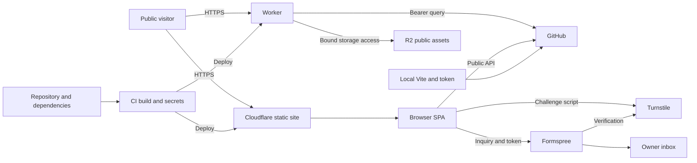

## Executive summary

Implementation status: this model records the pre-fix audit snapshot. Local
remediations and validation limits are recorded in the implementation follow-up
at the top of `security-audit-2026-10-19.md`. They are not yet deployed.

The public portfolio has a small application attack surface: no visitor accounts or private database, a fixed GitHub contributions proxy, public assets, and a provider-hosted contact intake. The strongest demonstrated abuse path is anonymous consumption of authenticated GitHub quota. Browser header gaps and vulnerable local/build tooling also deserve action. No critical/high application exploit or compromise was established. Reviewed 2026-10-19 at local commit `70da79b`; detailed findings are in `security-audit-2026-10-19.md`.

## Scope and assumptions

- In scope: `src/`, `index.html`, `public/`, Vite, Wrangler, npm lockfile, and GitHub Actions. Runtime and build risks are distinguished below.
- Owner confirms `frdndr.com` is production, no login/private dashboard exists, inquiries are ordinary contact details, and Formspree Turnstile verification is enabled. API rate limiting was not confirmed enabled.
- Out of scope: linked NoBogey/Mvolo applications, provider internals, intrusive testing, account changes, full secret-history inspection, and physical/local compromise.
- Open questions: actual token permissions and sharing; Cloudflare rules across all hostnames; branch/environment protection; Formspree rejection behavior; bucket exposure policies. These can lower quota risk or raise credential-compromise impact.
- No assumption of anonymous repository writes, arbitrary uploads, or a compromised provider. These are prerequisites for conditional threats rather than existing attacker capabilities.

## System model

### Primary components

- React SPA built with Vite/TypeScript (`package.json`, `src/main.tsx`, `src/App.tsx`). Content is developer-controlled in `src/data/portfolio.ts`; project routing matches known slugs (`src/App.tsx:195-196`).
- Cloudflare static hosting with SPA fallback and selected Worker-first paths (`wrangler.jsonc:23-26`). Worker fetches fixed GitHub GraphQL data and allowlisted R2 assets (`src/worker/index.ts:58-169`).
- Browser fetches public GitHub profile/repositories and loads Turnstile; contact POST goes directly to Formspree (`src/components/GithubSection.tsx:32-61`, `src/components/Turnstile.tsx:22-42`, `src/App.tsx:165-175`).
- GitHub Actions installs/builds and deploys main with secrets; pull requests build without the deploy step (`.github/workflows/ci.yml:12-53`). Local Vite middleware separately accesses GitHub with a local token (`vite.config.ts`, `configureServer`).

### Data flows and trust boundaries

- Internet → Cloudflare static hosting → browser: public HTML/JS/CSS/résumé over HTTPS; no authentication expected. Live homepage has no explicit CSP/framing/nosniff policies. Repo routing anchor: `wrangler.jsonc:23-26`.
- Internet → Worker → GitHub: attacker-supplied year is bounded; fixed login/query/HTTPS destination, server bearer token, generic public failures. No in-handler rate limit/cache lookup/timeout; response advertises five-minute cacheability (`src/worker/index.ts:121-169`).
- Internet → Worker → R2: fixed object keys; media bodies stream over HTTPS to callers. Video method/range checks exist; image keys are allowlisted. Bucket binding provides privileged storage access, not caller credentials (`src/worker/index.ts:58-118`, `wrangler.jsonc:17-21`).
- Browser → GitHub public REST: profile/repository JSON over HTTPS without bearer token; rendered with JSX. No runtime schema/URL allowlist for upstream repository links; upstream compromise would be a prerequisite (`src/components/GithubSection.tsx:32-42,70`).
- Browser ↔ Turnstile → Formspree → owner inbox: public widget key, challenge token, name/email/message over HTTPS; local validation plus owner-confirmed receiving-provider CAPTCHA verification. Client session flag is bypassable (`src/App.tsx:138-186`, `README.md:23-41`). Provider storage/retention policies were not inspected.
- Browser → third-party script/fonts: Turnstile JavaScript executes in the page; fonts use Google hosts. These providers are trust dependencies (`src/components/Turnstile.tsx:34`, `src/styles.css:1`).
- Repository/npm/actions → CI → Cloudflare: lockfile-based install and read-only GitHub permissions; main deploy receives scoped-in-principle credentials whose actual scope is unknown. Actions reference mutable tags (`.github/workflows/ci.yml:12-53`).
- Developer/browser → local Vite → GitHub: local requests can invoke a fixed token-bearing query; no explicit public bind configured. Treat local development separately and avoid public exposure (`vite.config.ts`, `configureServer`, `server`).

#### Diagram

## Assets and security objectives

| Asset | Why it matters | Security objective (C/I/A) |
|---|---|---|
| GitHub token and quota | Token must stay private; quota drives graph availability and possibly shared integrations | C/A |
| Deployment credentials and output | Can change website and Worker behavior | C/I |
| Contact details/messages | Names, email addresses, inquiry content entrusted to providers | C/I |
| Inbox/form allowance | Spam can obscure real inquiries or consume allowance | A |
| Public site/media and reputation | Defacement, deceptive content, unavailable portfolio | I/A |
| Developer/CI processes | Tooling execution may expose local or deployment credentials | C/I/A |

## Attacker model

### Capabilities

Anonymous remote users can request the public site, API, and media, select arbitrary query strings/methods/ranges, bypass client code, and POST directly to the public Formspree endpoint. They can host a framing page and make requests to configured alternative hostnames. npm/action compromise is modeled only as a conditional supply-chain capability.

### Non-capabilities

Remote users cannot normally read Worker secrets, choose GraphQL query/login/host, select arbitrary R2 keys, write repository content, deploy, upload files, or access a private application account. No database, tenant isolation, authenticated state-changing API, or file parser is exposed in the reviewed runtime. A local attacker or compromised upstream provider requires an additional foothold.

## Entry points and attack surfaces

| Surface | How reached | Trust boundary | Notes | Evidence (repo path / symbol) |
|---|---|---|---|---|
| Homepage and project routes | Public HTTPS | Hosting/browser | Static content and known project slugs | `wrangler.jsonc:23-26`; `src/App.tsx:195` |
| Contributions | `/api/github/contributions?year=` | Anonymous caller/privileged Worker/GitHub | Bounded year, fixed query, no handler limiter | `src/worker/index.ts:121-169` |
| Images/video | Four Worker paths | Anonymous caller/R2 binding | Allowlist; video byte ranges | `src/worker/index.ts:58-118` |
| Contact | Public Formspree POST | Browser/provider/inbox | Owner confirms verification enabled | `src/App.tsx:146-186` |
| Upstream data/scripts/fonts | Automatic browser requests | Browser/providers | JSX escaping; trusted script provider | `src/components/GithubSection.tsx`; `src/components/Turnstile.tsx`; `src/styles.css:1` |
| Dependency/install/deploy | PR/main/scheduled CI | Dependencies/CI/production | PR deploy excluded | `.github/workflows/ci.yml:3-53`; `package-lock.json` |
| Local proxy | Local dev server route | Local listener/GitHub token | Public reachability not established | `vite.config.ts`, `configureServer` |

## Top abuse paths

1. **Quota exhaustion:** anonymous caller requests contributions repeatedly → Worker invokes authenticated GitHub requests → quota/secondary limits degrade the graph. Alternative hostnames may bypass custom-domain-only protections. Local mocked requests confirm handler execution per call.
2. **Inbox abuse:** caller bypasses sessionStorage/field checks → submits directly to Formspree with valid challenge tokens → residual spam consumes allowance. Owner-confirmed verification blocks the simpler missing-token path if configured correctly; not independently tested.
3. **Deceptive framing:** attacker embeds the portfolio → overlays misleading prompts → induces unwanted navigation/contact interactions. Missing framing headers support this path, but there is no account or privileged transaction to steal.
4. **Dependency exploitation:** attacker-controlled advisory-specific SVG/source map/network input reaches vulnerable local tooling → developer/CI process crashes or is compromised depending on the advisory. Requires a processing path not established in this review; package presence alone does not prove exploitation.
5. **Release supply-chain compromise:** attacker controls a referenced action/dependency release → code runs in CI → malicious deploy or secret theft if privileges are reached. Read-only repository permissions and PR deploy gating reduce exposure; a normal anonymous visitor cannot trigger this chain alone.
6. **Asset resource abuse:** caller repeatedly requests fixed video/image bodies or valid ranges → Worker/R2 operations increase → costs or availability degrade. Allowlisting and video range validation block arbitrary object selection; provider caches/billing limits were not inspected.
7. **Third-party browser compromise:** trusted script provider compromised → script executes on the portfolio → reads entered inquiry data or changes displayed links. No compromise evidence; CSP reduces unrelated script injection but cannot fully contain a deliberately trusted compromised script.

## Threat model table

| Threat ID | Threat source | Prerequisites | Threat action | Impact | Impacted assets | Existing controls (evidence) | Gaps | Recommended mitigations | Detection ideas | Likelihood | Impact severity | Priority |
|---|---|---|---|---|---|---|---|---|---|---|---|---|
| TM-001 | Anonymous caller | Public endpoint; no effective edge limit | Repeated token-backed calls | Graph outage/shared quota drain | GitHub quota | Fixed query/user, bounded year, generic errors (`src/worker/index.ts:125-169`) | No handler limiter/cache lookup/timeout; all methods execute | Canonical cached/precomputed calendars; GET/HEAD gate; timeout; limits on all hostnames; keep local dev private | API traffic, upstream 403/429, remaining quota, latency | High: trivial repeated requests | Medium: bounded availability harm; sharing could widen it | medium |
| TM-002 | Spammer | Valid CAPTCHA tokens or provider misconfiguration | Bypass local limits and submit inquiries | Spam/form allowance loss | Inbox/messages | Token flow and refresh (`src/App.tsx:165-186`); owner confirms verification | Browser-only session/word limits; provider behavior untested | Verify rejection cases and provider quotas; server validation only where needed | Spam/allowance/rejection trends | Medium: verification adds cost | Low: ordinary inquiry service | low |
| TM-003 | Framing attacker or future injector | Victim visits attacker page; injection needs separate flaw | Frame site or exploit absent containment | Deceptive interaction; conditional script execution | Visitor trust/inquiry data | React text rendering (`src/App.tsx`); no unsafe sinks found | Live homepage lacks explicit security headers | Static and Worker headers; staged CSP with Turnstile support | Header regression check, CSP reports | Medium for framing; low for unproven injection | Low for framing; higher only with separate injection | low |
| TM-004 | Malicious input/dependency actor | Vulnerable tooling consumes advisory-specific input | Trigger tooling vulnerability | Crash or advisory-dependent compromise | Developer/CI process | Lockfile and npm ci (`.github/workflows/ci.yml:34-35`) | Five high npm entries, no CI advisory check | Reviewed dependency refresh; synchronize CI Wrangler; audit automation | Audit deltas and abnormal build failures | Low: input reachability unproven | High if process compromise reaches secrets; DoS impact lower | medium |
| TM-005 | Compromised release/repo actor | Action/dependency control or authorized repo foothold | Execute in deploy job | Defacement/credential theft | Deployment secrets/site | Read-only permissions and PR deploy gate (`.github/workflows/ci.yml:12-13,42`) | Mutable action tags; token scopes/protection unknown | SHA pins, automated updates, scope secrets, confirm protected production changes | Deployment/action provenance and account alerts | Low: privileged upstream foothold required | High: production integrity | low |
| TM-006 | Anonymous downloader | Public R2 media routes | Repeated downloads/ranges | Operation/cost pressure | Hosting availability/budget | Fixed keys, streaming, cache headers, video validation (`src/worker/index.ts:58-118`) | No handler limiter/cache lookup; actual edge caching unknown | Measure cache hit/costs; cache media where supported; budget alerts and justified limits | R2 operations, bytes, Worker invocation spikes | Medium: easy, but provider mitigation unknown | Low for this portfolio absent demonstrated budget harm | low |
| TM-007 | Compromised third party | Trusted browser script/provider control | Alter page/read inquiry fields | Privacy/integrity loss | Inquiry data/site reputation | Fixed HTTPS script host; escaped GitHub text (`src/components/Turnstile.tsx:34`; `src/components/GithubSection.tsx:70`) | No live CSP; provider trust remains | Minimize trusted scripts; CSP origin allowlist; retain JSX escaping; optional GitHub-link origin/schema validation | CSP anomalies, provider incidents, unexpected script changes | Low: provider foothold needed | Medium: inquiry content, no sessions | low |

## Criticality calibration

- **Critical:** scalable compromise across deployment accounts or broad credential exfiltration with immediate privileged access. Examples: demonstrated public deploy-token extraction with broad account scope; unauthenticated production code execution spanning bound resources. Neither found.
- **High:** demonstrated theft of a privileged Worker/deploy secret; malicious production deployment via a reachable CI flaw. Requires evidence beyond known package advisories or mutable tags.
- **Medium:** repeatable authenticated GitHub quota depletion; known tooling advisories requiring a reviewed remediation despite unproven production reachability. These merit near-term work without asserting full-site compromise.
- **Low:** residual spam behind enabled verification; clickjacking of a public portfolio; hypothetical provider compromise requiring a separate foothold. Missing CSP is defense-in-depth absent an injection path.

Ranking depends most on token sharing/permissions, actual edge controls across hostnames, reachability of tooling advisory paths, and Formspree's enabled verification working as expected. No runtime high/critical threat is established, so there is no evidence-backed emergency remediation claim. For conditional TM-004/TM-005 compromise, scope secrets, monitor provider access/deploy logs, and rotate credentials if exposure is actually detected.

## Focus paths for security review

| Path | Why it matters | Related Threat IDs |
|---|---|---|
| `src/worker/index.ts` | Token-backed quota and fixed media responses | TM-001, TM-006 |
| `wrangler.jsonc` | Hostnames, secret/R2 bindings, static/Worker response boundaries | TM-001, TM-003, TM-006 |
| `src/App.tsx` | Contact validation/token submission and safe content rendering | TM-002, TM-003 |
| `src/components/Turnstile.tsx` | Trusted script and challenge lifecycle | TM-002, TM-007 |
| `src/components/GithubSection.tsx` | Public upstream data, links, refresh requests | TM-001, TM-007 |
| `index.html` and `public/` | HTML/header delivery and public artifacts | TM-003 |
| `vite.config.ts` | Local token-bearing proxy and listener assumptions | TM-001, TM-004 |
| `package.json` and `package-lock.json` | Tooling dependency advisories | TM-004, TM-005 |
| `.github/workflows/ci.yml` | Installation, action trust, deployment secrets | TM-004, TM-005 |

## Notes on use

- Coverage check: static/deep routes, contributions, image/video ranges, contact, upstream browser integrations, CI and local middleware represented; all discovered trust boundaries mapped to threats.
- Runtime and CI/local tooling risks are separate. Owner clarifications are reflected; dashboard settings beyond those answers remain open.
- No intrusive requests, spam, real token abuse, deployment, fixes, or account changes occurred. Live observations cover apex homepage and one API GET; source/deployment parity is unverified.
- Existing generated JS did not contain the local GitHub token; this does not prove all historical/deployed artifacts are secret-free.
- Official control references and audit evidence are linked in `security-audit-2026-10-19.md`. This model should be revisited if accounts, uploads, private data, or new APIs are added.
